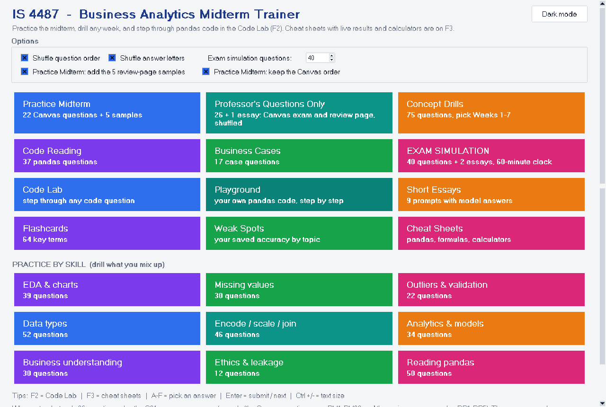
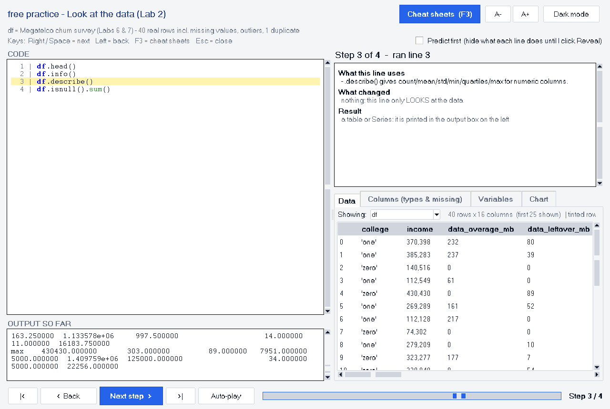
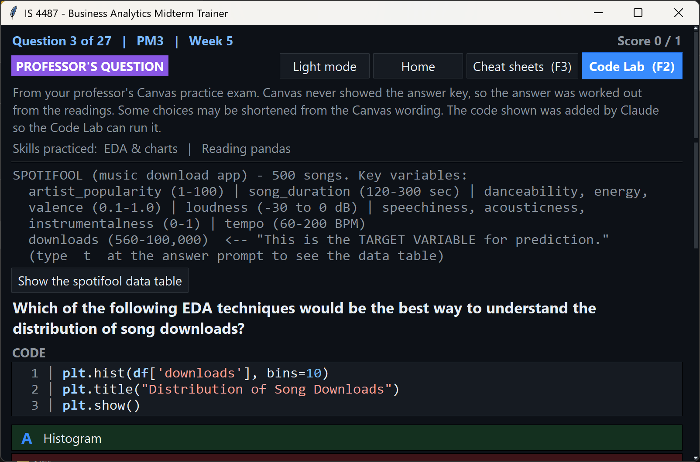
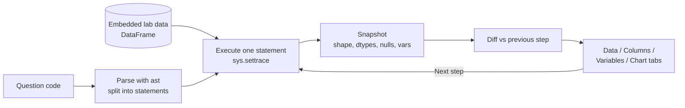

# IS 4487 – Business Analytics Midterm Trainer

A study app for a business analytics (pandas / data science) midterm. Its **Code Lab** runs each question's pandas code **one statement at a time** on real lab data and shows exactly what changed. One self-contained file; Python 3.8+ with Tkinter.



## Features
- Practice midterm, concept drills by week, code-reading questions, business cases, and short essays with model answers
- **Exam simulation** with a 60-minute clock and essay questions
- **Code Lab (F2):** steps through pandas code statement by statement and shows rows, columns, dtypes, missing values, new variables, printed output and charts, with an optional *predict first* mode
- Detailed feedback on every miss: why the right answer is right, why yours isn't, what the code really outputs, and key terms to review
- Flashcards, weak-spot tracking, live cheat sheets and calculators (F3)
- Every question is tagged by source; progress is saved locally

## Screenshots
| Code Lab: stepping through pandas | Feedback on a wrong answer |
|---|---|
|  |  |

## How the Code Lab works


## Run it
```bash
python IS4487_Midterm_Trainer.py
```
The quizzes need nothing else. For the Code Lab and live cheat sheets:
```bash
pip install -r requirements.txt
```
